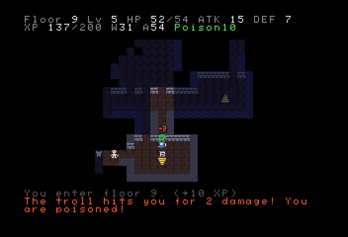
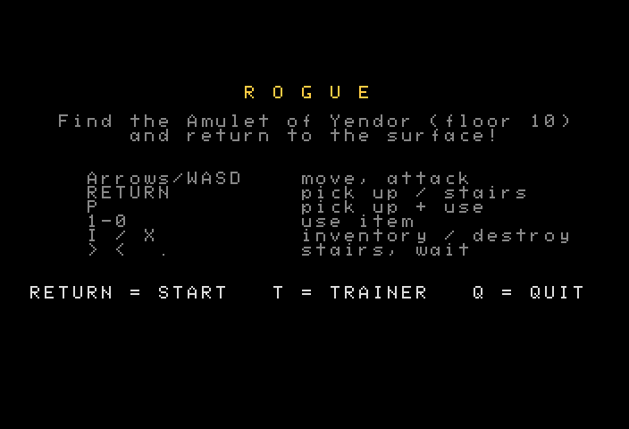
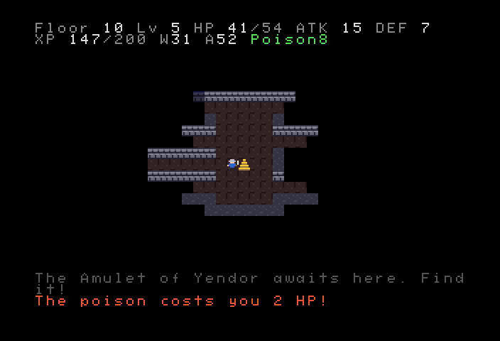
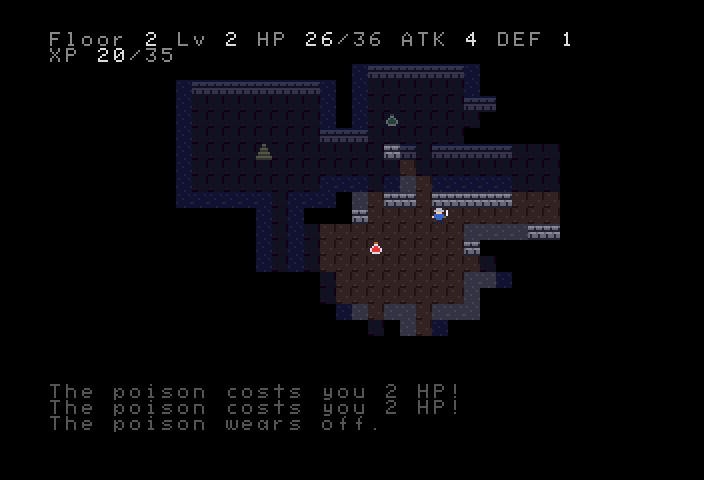
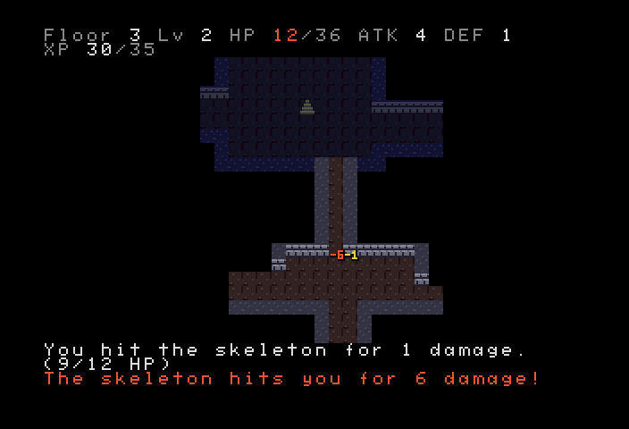
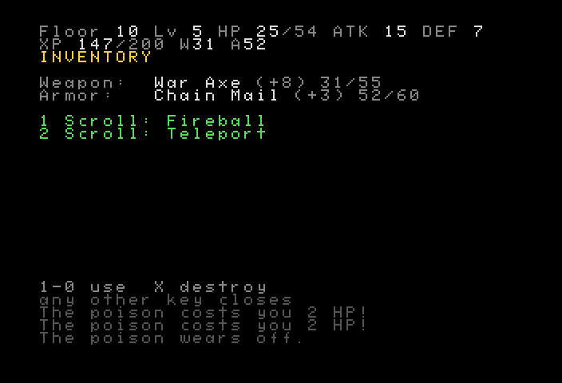
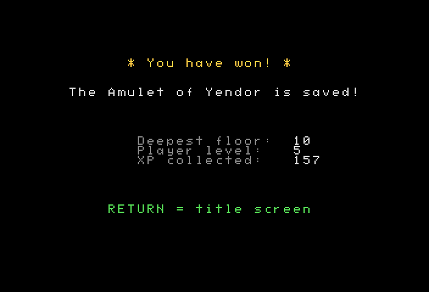
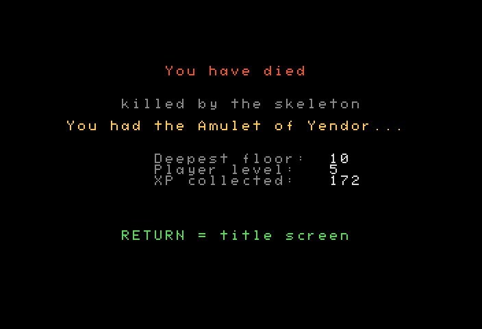

# Rogue for the Aquarius+

A classic turn-based dungeon crawler for the [Aquarius+](https://github.com/fvdhoef/aquarius-plus) home computer.
Dive ten floors deep into a randomly generated dungeon, find the **Amulet of Yendor** and
make it back to the surface alive.



Every game builds a new dungeon. Rooms, corridors, monsters and loot are different each time,
and death is permanent.

The game comes in two language versions with identical gameplay:

| File | Language |
|---|---|
| `rogue_en.aqx` | English |
| `rogue_de.aqx` | German |

---

## Contents

- [Getting started](#getting-started)
- [Goal of the game](#goal-of-the-game)
- [Controls](#controls)
- [The screen](#the-screen)
- [How the game works](#how-the-game-works)
- [Monsters](#monsters)
- [Items](#items)
- [Status effects](#status-effects)
- [Winning and dying](#winning-and-dying)
- [Trainer mode](#trainer-mode)
- [Tips](#tips)

---

## Getting started

1. Copy `rogue_en.aqx` to your Aquarius+ SD card.
2. At the BASIC prompt, type:

   ```
   RUN "rogue_en.aqx"
   ```

3. The title screen appears. Press **RETURN** to start a new game.



On the title screen:

| Key | Action |
|---|---|
| **RETURN** | Start a new game |
| **T** | Toggle trainer mode on/off (see [Trainer mode](#trainer-mode)) |
| **Q** | Quit to BASIC |

There is no save game yet. A game lasts until you win, die or press **Q**.

---

## Goal of the game

The Amulet of Yendor lies on **floor 10**, the deepest level of the
dungeon. Find it, pick it up, then climb all the way back to **floor 1** and press **`<`**
to escape.



---

## Controls

| Key | Action |
|---|---|
| **Cursor keys** / **W A S D** / joystick | Move one step. Moving into a monster attacks it. |
| **RETURN** / **Space** / fire button | Pick up the item you are standing on. With no item there, use the stairs. |
| **P** | Pick up and immediately use or equip the item |
| **1** … **9**, **0** | Use or equip item 1 … 10 from your inventory |
| **I** / **Tab** | Open the inventory |
| **X** | Destroy an item (then press its number) |
| **`>`** | Go down the stairs |
| **`<`** | Go up the stairs, or escape on floor 1 if you carry the amulet |
| **`.`** | Wait one turn |
| **Q** | Give up and return to the title screen |

Holding a direction key keeps you walking.

Keys are read as characters from the keyboard, so they follow your keyboard layout.
On a German keyboard, `<` and `>` share the key next to the left Shift key. On a US
layout they are **Shift + ,** and **Shift + .**. If in doubt, stand on the stairs and press
**RETURN**: that works on every layout.

---

## The screen



**Status bar (top two lines)**

| Shown | Meaning |
|---|---|
| `T` | Trainer mode is on (only shown then) |
| `Floor 3` | Current floor (1-10) |
| `Lv 2` | Your character level |
| `HP 26/36` | Hit points / maximum. Turns red when you are down to a third. |
| `ATK 4` | Attack value (base + weapon bonus) |
| `DEF 1` | Defense value (base + armor bonus) |
| `XP 30/35` | Experience points / points needed for the next level |
| `W31` | Durability left on your weapon |
| `A52` | Durability left on your armor |
| `Poison4` | An active status effect and the turns it has left (here: poisoned, 4 turns) |
| `AMULET` | You carry the Amulet of Yendor |

**The map (middle)**

- Brightly lit areas are what you can **see right now** (sight radius 8).
- Dimmed areas are places you have **already explored**. You remember the layout, but you
  cannot see monsters there.
- Black areas are still unexplored.
- The view scrolls smoothly to follow your hero.

**Messages (bottom three lines)**

The newest messages appear in bright colors, older ones fade to grey. Red means danger
(you were hit, poisoned, an item broke), gold means something important (level up,
stairs, amulet), green means healing.

---

## How the game works

### Turns

Rogue is turn-based. Nothing happens until you act. Every step, attack, item use or
wait (`.`) takes one turn, and then every awake monster takes its turn. Opening the
inventory is free.

### Floors and stairs

- Each floor is a set of rooms joined by corridors.
- The **down stairs** (`>`) lead deeper, the **up stairs** (`<`) lead back. Floor 1 has
  no up stairs.
- Floors you have visited are **remembered**: map, monsters and items stay as you left
  them.
- Entering a **new** floor for the first time gives **+10 XP**.

### Secret rooms

Some floors hide up to two secret rooms behind secret doors. Walk next to the hidden door
and it is revealed automatically (*"You discover a secret door!"*), which gives
**+15 XP**. Secret rooms often hold extra loot.

### Combat

Walk into a monster to attack it. Every attack rolls a 20-sided die:

| Roll | Result |
|---|---|
| 1 | Miss |
| 2-19 | Hit: damage = attack − defender's defense ± 2, at least 1 |
| 20 | Critical hit: double damage |

Monsters attack you the same way. Damage numbers float above whoever was hit, and the
victim's sprite flashes.



### Experience and levels

Killing monsters, reaching new floors and finding secret doors give experience points.
Each new level gives **+6 max HP**, **+1 attack** and **+1 defense**, and **fully heals** you.

| Level | 2 | 3 | 4 | 5 | 6 | 7 | 8 | 9 | 10 |
|---|---|---|---|---|---|---|---|---|---|
| XP needed | 15 | 35 | 70 | 120 | 200 | 300 | 450 | 650 | 900 |

You start at level 1 with **30 HP, attack 3, defense 0**. Level 10 is the maximum.

### Monster behaviour

Monsters sleep until they see you. Once awake, they hunt you along the shortest path and
attack when they are next to you. Monsters can move diagonally. You move only in four
directions.

---

## Monsters

Deeper floors bring more monsters (4 on floor 1, up to 8 from floor 5 on) and tougher
kinds.

| Monster | HP | Attack | Defense | XP | From floor | Special |
|---|---|---|---|---|---|---|
| Rat | 4 | 2 | 0 | 2 | 1 | 30 % chance to poison (6 turns) |
| Goblin | 8 | 4 | 1 | 5 | 2 | – |
| Skeleton | 12 | 5 | 2 | 8 | 3 | 20 % chance to confuse (3 turns) |
| Orc | 18 | 7 | 3 | 12 | 4 | – |
| Troll | 30 | 10 | 4 | 20 | 5 | 40 % chance to poison (10 turns) |

---

## Items

Items lie on the floor of rooms. Step on one to see its name, then pick it up with
**RETURN** or use/equip it straight away with **P**. Better items only appear on deeper
floors.

### Inventory

You can carry **10 items**. Press **I** to see them, with your equipped weapon and armor at
the top. Press a number key to use an item, **X** and then a number to destroy one, or
any other key to close the list.



If your inventory is full, you can still drink a potion or read a scroll from the floor
with **P**.

### Weapons and armor

Equipping a weapon or armor puts your old one back into the inventory slot. Equipment
wears out: every hit you deal wears your weapon, every hit you take wears your armor
(by half the damage). When durability reaches zero, the item breaks.
Keep an eye on `W` and `A` in the status bar.

| Weapon | Attack bonus | Durability | From floor |
|---|---|---|---|
| Dagger | +2 | 25 | 1 |
| Short Sword | +4 | 35 | 1 |
| Long Sword | +6 | 45 | 3 |
| War Axe | +8 | 55 | 5 |

| Armor | Defense bonus | Durability | From floor |
|---|---|---|---|
| Leather Armor | +1 | 40 | 1 |
| Chain Mail | +3 | 60 | 2 |
| Plate Armor | +5 | 80 | 4 |

### Potions

| Potion | Effect | From floor |
|---|---|---|
| Small Healing Potion | Heals 10 HP | 1 |
| Large Healing Potion | Heals 25 HP | 2 |
| Antidote Potion | Cures poison | 1 |
| Regeneration Potion | +1 HP every turn for 10 turns | 2 |
| Invisibility Potion | Monsters ignore you for 12 turns | 2 |

### Scrolls

| Scroll | Effect | From floor |
|---|---|---|
| Scroll: Teleport | Moves you to a random spot on the floor | 1 |
| Scroll: Magic Map | Reveals the whole floor | 1 |
| Scroll: Fireball | 12 damage to every monster within 4 squares | 3 |

---

## Status effects

| Effect | Shown as | What it does | How it ends |
|---|---|---|---|
| Poison | `Poison` | You lose 2 HP every turn | Runs out, or drink an antidote |
| Confusion | `Confused` | You stumble in a random direction when you move | Runs out |
| Regeneration | `Regen.` | You gain 1 HP every turn | Runs out |
| Invisibility | `Invisible` | Monsters cannot see you and wander around | Runs out |

---

## Winning and dying

**You win** if you carry the Amulet of Yendor on floor 1 and press **`<`**.



**You die** when your HP reach 0. The end screen shows what killed you
(*killed by the …* or *poisoned*), the deepest floor you reached,
your level and your XP. Press **RETURN** to return to the title screen.



---

## Trainer mode

Press **T** on the title screen to switch trainer mode on (*Trainer mode: ON*). In trainer
mode you cannot die: when a blow would kill you, your HP are fully restored instead. A gold
`T` in the status bar reminds you that it is on. Use it to learn the game or to explore
the deeper floors.

---

## Tips

- **Don't rush the stairs.** The early floors are your chance to collect XP and equipment
  before the trolls show up.
- **Fight in corridors.** In a corridor only one or two monsters can reach you at a time.
- **Watch your durability.** Carry a spare weapon once `W` gets low. A broken weapon
  leaves you with your bare base attack.
- **Keep an antidote** for the deeper floors. Troll poison lasts 10 turns, which is 20 HP.
- **Save invisibility or teleport for emergencies.** Either one lets you escape a fight
  you are losing, and fireball can clear a crowded room.
- **Read magic maps on big floors** to find the stairs, or the amulet on floor 10, quickly.
- **The way back is dangerous.** The monsters you skipped on the way down are still there.

---

Rogue for the Aquarius+ is a port of a browser version written in TypeScript with ROT.js.
